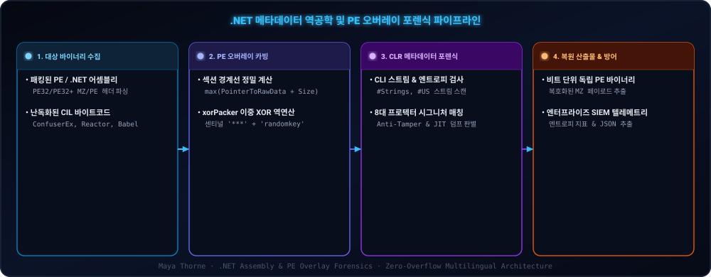

<div align="center">

<p align="center">
  <a href="./en.md">🇺🇸 English</a> · <a href="./ko.md">🇰🇷 한국어</a> · <a href="./zh-CN.md">🇨🇳 中文</a> · <a href="./es.md">🇪🇸 Español</a> · <a href="./hi.md">🇮🇳 हिन्दी</a><br />
  <a href="./ar.md">🇸🇦 العربية</a> · <a href="./pt-BR.md">🇧🇷 Português</a> · <a href="./ru.md">🇷🇺 Русский</a> · <a href="./fr.md">🇫🇷 Français</a> · <a href="./id.md">🇮🇩 Bahasa Indonesia</a>
</p>

<p align="center">
  <a href="https://github.com/maya-thorne/dotnet-packer-forensics"></a>
</p>

# 🔬 dotnet-packer-forensics

**.NET 메타데이터 분석, PE 오버레이 정적 언패커 및 역공학 연구실**

[](#4-저장소-구조--소스-모듈-명세)
[](#1-시스템-아키텍처-및-포렌식-파이프라인)
[](#3-핵심-연구-백서-인덱스)
[](https://github.com/maya-thorne/dotnet-packer-forensics/releases)
[](../../LICENSE)

<sub>Engineered &amp; Audited by **[Maya Thorne](https://github.com/maya-thorne)** · Low-Level Systems &amp; Reverse Engineering Research</sub>

<br />

<p align="center">
  <a href="#1-시스템-아키텍처-및-포렌식-파이프라인"><b>🏛️ 아키텍처</b></a> •
  <a href="#2-cli-도구체인-및-실무-사용법"><b>💻 CLI 도구체인</b></a> •
  <a href="#3-핵심-연구-백서-인덱스"><b>📚 연구 백서</b></a> •
  <a href="#4-저장소-구조--소스-모듈-명세"><b>📁 저장소 구조</b></a> •
  <a href="#5-라이선스-및-오픈소스-연구-크레딧"><b>📜 라이선스</b></a>
</p>

</div>

---

<span id="table-of-contents"></span>
## 📑 목차 (Table of Contents)

- [🏛️ 1. 시스템 아키텍처 및 포렌식 파이프라인](#1-시스템-아키텍처-및-포렌식-파이프라인)
- [💻 2. CLI 도구체인 및 실무 사용법](#2-cli-도구체인-및-실무-사용법)
  - [빠른 설치 및 실행 (Quickstart)](#quickstart-installation)
  - [CLI 옵션 매트릭스](#cli-options-matrix)
- [📚 3. 핵심 연구 백서 인덱스](#3-핵심-연구-백서-인덱스)
- [📁 4. 저장소 구조 & 소스 모듈 명세](#4-저장소-구조--소스-모듈-명세)
  - [📦 핵심 언패커 패키지 (`dotnet_deobfuscator/`)](#core-deobfuscator-package)
  - [🧪 포렌식 샘플 바이너리 코퍼스 (`samples/`)](#forensic-sample-corpus)
  - [🔬 자동 검증 및 리그레션 테스트 스위트 (`tests/`)](#test-validation-suite)
- [📜 5. 라이선스 및 오픈소스 연구 크레딧](#5-라이선스-및-오픈소스-연구-크레딧)

---

<span id="1-시스템-아키텍처-및-포렌식-파이프라인"></span><span id="architecture-pipeline"></span>
<details open>
<summary><h2 style="display:inline-block; margin:0;" id="1-시스템-아키텍처-및-포렌식-파이프라인">🏛️ 1. 시스템 아키텍처 및 포렌식 파이프라인</h2></summary>

<br />

`dotnet-packer-forensics`는 외부 의존성(Zero-Dependency) 없이 순수 파이썬으로 동작하는 역공학 엔진으로, PE 오버레이 카빙, 2단계 이중 XOR 역복호화(xorPacker), 그리고 8대 주요 .NET 보호기(ConfuserEx, .NET Reactor, Eazfuscator, Babel, ArmDot 등)의 CIL 메타데이터 스트림과 섹션 엔트로피를 정밀 분석합니다.

<p align="center">
  <a href="https://github.com/maya-thorne/dotnet-packer-forensics"></a>
</p>

</details>

---

<span id="2-cli-도구체인-및-실무-사용법"></span><span id="cli-toolchain"></span>
<details open>
<summary><h2 style="display:inline-block; margin:0;" id="2-cli-도구체인-및-실무-사용법">💻 2. CLI 도구체인 및 실무 사용법</h2></summary>

<br />

<p align="center">
  
</p>

<span id="quickstart-installation"></span>
### Quickstart Installation
```bash
# Clone the repository
git clone https://github.com/maya-thorne/dotnet-packer-forensics.git
cd dotnet-packer-forensics

# Run directly via Python module
python -m dotnet_deobfuscator samples/xorPacker_packed_sample.exe -v

# Or extract decrypted payload directly to disk
python -m dotnet_deobfuscator samples/xorPacker_packed_sample.exe -o unpacked_payload.exe
```

<span id="cli-options-matrix"></span>
### CLI Options Matrix
| Flag | Description | Default |
| :--- | :--- | :---: |
| `target` | Path to target executable (`.exe` / `.dll`) | *Required* |
| `-o, --output` | Output file path for extracted decrypted payload | None |
| `-k, --key` | Master XOR key for overlay decryption | `'randomkey'` |
| `--format` | Output telemetry format (`text` or `json`) | `text` |
| `-v, --verbose` | Verbose section topology and entropy metrics | `False` |
| `--version` | Display engine version and exit | `v1.0.0` |

</details>

---

<span id="3-핵심-연구-백서-인덱스"></span><span id="research-whitepapers"></span>
<details open>
<summary><h2 style="display:inline-block; margin:0;" id="3-핵심-연구-백서-인덱스">📚 3. 핵심 연구 백서 인덱스</h2></summary>

<br />

<table width="100%">
  <thead>
    <tr>
      <th width="22%"><nobr>Whitepaper Document</nobr></th>
      <th width="78%"><nobr>Technical Scope &amp; Forensic Highlights</nobr></th>
    </tr>
  </thead>
  <tbody>
    <tr>
      <td>🔬 <b><a href="../whitepapers/DOTNET_OBFUSCATION_ARCHITECTURE_AND_CODE_ANALYSIS.md">DOTNET_<wbr>OBFUSCATION_<wbr>ARCHITECTURE_<wbr>AND_<wbr>CODE_<wbr>ANALYSIS.md</a></b></td>
      <td>CIL Bytecode &amp; CLI Metadata Streams, dnlib AST Parsing, ConfuserEx Pipeline Phases</td>
    </tr>
    <tr>
      <td>🔏 <b><a href="../whitepapers/XORPACKER_AND_PE_OVERLAY_FORENSICS.md">XORPACKER_<wbr>AND_<wbr>PE_<wbr>OVERLAY_<wbr>FORENSICS.md</a></b></td>
      <td>Section Boundary Calculations, <code>***</code> Sentinel Seeking, Dynamic Key Inversion</td>
    </tr>
    <tr>
      <td>🛡️ <b><a href="../whitepapers/CONFUSEREX_8_PROTECTIONS_DEEP_DIVE.md">CONFUSEREX_<wbr>8_<wbr>PROTECTIONS_<wbr>DEEP_<wbr>DIVE.md</a></b></td>
      <td>Control Flow Flattening, Anti-Tamper JIT In-Memory Decryption, Dynamic Ciphers</td>
    </tr>
    <tr>
      <td>🏢 <b><a href="../whitepapers/ENTERPRISE_DOTNET_PROTECTORS_MATRIX.md">ENTERPRISE_<wbr>DOTNET_<wbr>PROTECTORS_<wbr>MATRIX.md</a></b></td>
      <td>Architectural Comparison of 8 COTS &amp; Open Source Packers (.NET Reactor, Eazfuscator, Babel)</td>
    </tr>
  </tbody>
</table>

</details>

---

<span id="4-저장소-구조--소스-모듈-명세"></span><span id="repository-structure"></span>
<details open>
<summary><h2 style="display:inline-block; margin:0;" id="4-저장소-구조--소스-모듈-명세">📁 4. 저장소 구조 &amp; 소스 모듈 명세</h2></summary>

<br />

본 프로젝트는 순수 무의존성 정적 포렌식 패키지(`dotnet_deobfuscator/`), 실전 패커 바이너리 코퍼스(`samples/`), 그리고 전자동 단위/통합 테스트 스위트(`tests/`) 3개 계층으로 모듈화되어 있습니다.

<span id="core-deobfuscator-package"></span>
### 📦 핵심 언패커 패키지 (`dotnet_deobfuscator/`)

<table width="100%">
  <thead>
    <tr>
      <th width="26%"><nobr>모듈 / 파일명</nobr></th>
      <th width="22%"><nobr>컴포넌트 역할</nobr></th>
      <th width="52%"><nobr>1줄 기술 스코프 및 포렌식 동작 명세</nobr></th>
    </tr>
  </thead>
  <tbody>
    <tr>
      <td><code>dotnet_deobfuscator/__init__.py</code></td>
      <td><b>패키지 초기화</b></td>
      <td>패키지 메타데이터, 시맨틱 버전(<code>v1.0.0</code>) 및 작성자(<code>Maya Thorne</code>) 크레딧 정의.</td>
    </tr>
    <tr>
      <td><code>dotnet_deobfuscator/__main__.py</code></td>
      <td><b>CLI 진입점</b></td>
      <td><code>python -m dotnet_deobfuscator</code> 호출 시 <code>cli.main()</code>으로 연결하는 실행 진입 모듈.</td>
    </tr>
    <tr>
      <td><code>dotnet_deobfuscator/cli.py</code></td>
      <td><b>CLI 및 텔레메트리</b></td>
      <td>명령줄 인자(<code>-o</code>, <code>-k</code>, <code>-v</code>, <code>--format</code>) 파싱, 종료 코드 및 텍스트/JSON 리포트 출력 제어.</td>
    </tr>
    <tr>
      <td><code>dotnet_deobfuscator/core.py</code></td>
      <td><b>포렌식 총괄 오케스트레이터</b></td>
      <td>PE 구조 파싱, 보호기 시그니처 매칭, 오버레이 카빙 및 언패킹 전 과정을 일괄 지휘.</td>
    </tr>
    <tr>
      <td><code>dotnet_deobfuscator/dotnet_analyzer.py</code></td>
      <td><b>메타데이터 &amp; 엔트로피</b></td>
      <td>샤논 바이트 엔트로피(0.0~8.0) 계산, CLI 메타데이터 스트림(<code>#Strings</code>, <code>#US</code>, <code>#Blob</code>, <code>#GUID</code>, <code>#~</code>) 및 런타임 검사.</td>
    </tr>
    <tr>
      <td><code>dotnet_deobfuscator/pe_overlay.py</code></td>
      <td><b>PE 오버레이 카빙 &amp; 복호화</b></td>
      <td>물리 PE 섹션 경계 계산, 오버레이 추출 및 xorPacker 2단계 동적 XOR 암호 역복호화 수행.</td>
    </tr>
    <tr>
      <td><code>dotnet_deobfuscator/signatures.py</code></td>
      <td><b>보호기 시그니처 매처</b></td>
      <td>8대 주요 .NET 프로텍터(ConfuserEx, .NET Reactor, Eazfuscator, Babel 등) 탐지 바이트/문자열 규칙 내장.</td>
    </tr>
  </tbody>
</table>

<span id="forensic-sample-corpus"></span>
### 🧪 포렌식 샘플 바이너리 코퍼스 (`samples/`)

<table width="100%">
  <thead>
    <tr>
      <th width="26%"><nobr>샘플 파일명</nobr></th>
      <th width="22%"><nobr>바이너리 유형</nobr></th>
      <th width="52%"><nobr>1줄 기술 스코프 및 포렌식 동작 명세</nobr></th>
    </tr>
  </thead>
  <tbody>
    <tr>
      <td><code>samples/xorPacker_packed_sample.exe</code></td>
      <td><b>패킹된 PE 바이너리</b></td>
      <td>xorPacker로 패킹되어 오버레이 영역에 2단계 동적 XOR 암호화 페이로드를 탑재한 실전 검증용 바이너리.</td>
    </tr>
    <tr>
      <td><code>samples/xorStub_sample.exe</code></td>
      <td><b>드롭퍼 스텁 바이너리</b></td>
      <td><code>***</code> 센티넬 구분자와 오버레이 복호화 스텁 로직을 내장한 네이티브 드롭퍼 바이너리.</td>
    </tr>
    <tr>
      <td><code>samples/unpacked_output.bin</code></td>
      <td><b>복호화 기준 페이로드</b></td>
      <td>정적 언패커 자동 검증 및 비트 단위 무결성 대조를 위한 정답(Ground Truth) 추출 페이로드.</td>
    </tr>
  </tbody>
</table>

<span id="test-validation-suite"></span>
### 🔬 자동 검증 및 리그레션 테스트 스위트 (`tests/`)

<table width="100%">
  <thead>
    <tr>
      <th width="26%"><nobr>테스트 모듈</nobr></th>
      <th width="22%"><nobr>테스트 도메인</nobr></th>
      <th width="52%"><nobr>1줄 기술 스코프 및 포렌식 동작 명세</nobr></th>
    </tr>
  </thead>
  <tbody>
    <tr>
      <td><code>tests/test_cli.py</code></td>
      <td><b>CLI 통합 검증</b></td>
      <td>명령줄 인자 처리 기본값, 텍스트 및 JSON 텔레메트리 보고서 생성 무결성 검증.</td>
    </tr>
    <tr>
      <td><code>tests/test_dotnet_analyzer.py</code></td>
      <td><b>메타데이터 &amp; 시그니처 검증</b></td>
      <td>샤논 엔트로피 경계치(0.0 vs &gt;7.9) 및 프로텍터 시그니처 매칭 로직의 정확도 검증.</td>
    </tr>
    <tr>
      <td><code>tests/test_pe_overlay.py</code></td>
      <td><b>오버레이 &amp; 언패커 검증</b></td>
      <td>XOR 암호 대칭성, 모의 패커 페이로드 생성 및 2단계 동적 키 역복호화 파이프라인 검증.</td>
    </tr>
  </tbody>
</table>

</details>

---

<span id="5-라이선스-및-오픈소스-연구-크레딧"></span><span id="license-attribution"></span>
<details>
<summary><h2 style="display:inline-block; margin:0;" id="5-라이선스-및-오픈소스-연구-크레딧">📜 5. 라이선스 및 오픈소스 연구 크레딧</h2></summary>

<br />

This project is licensed under the **Maya Thorne Systems &amp; Security Research License (MT-SRL)**. Copyright © 2026 Maya Thorne. All rights reserved. Published strictly for academic analysis, vulnerability research, and systems engineering.

</details>
