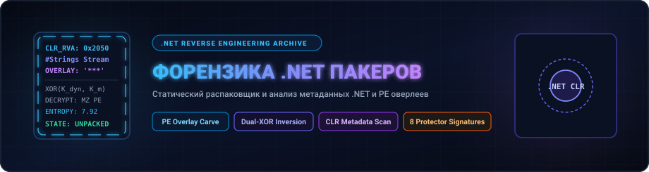
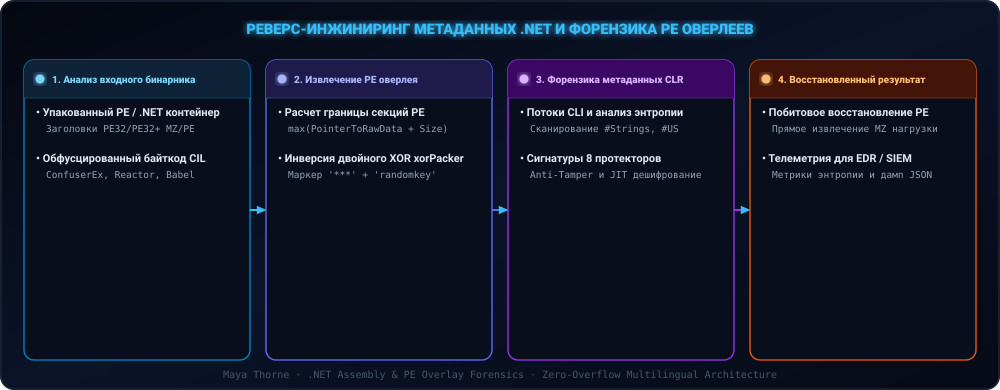

<div align="center">

<p align="center">
  <a href="./en.md">🇺🇸 English</a> · <a href="./ko.md">🇰🇷 한국어</a> · <a href="./zh-CN.md">🇨🇳 中文</a> · <a href="./es.md">🇪🇸 Español</a> · <a href="./hi.md">🇮🇳 हिन्दी</a><br />
  <a href="./ar.md">🇸🇦 العربية</a> · <a href="./pt-BR.md">🇧🇷 Português</a> · <a href="./ru.md">🇷🇺 Русский</a> · <a href="./fr.md">🇫🇷 Français</a> · <a href="./id.md">🇮🇩 Bahasa Indonesia</a>
</p>

<p align="center">
  <a href="https://github.com/maya-thorne/dotnet-packer-forensics"></a>
</p>

# 🔬 dotnet-packer-forensics

**Статический распаковщик PE оверлеев и анализ метаданных .NET**

[](#)
[](#)
[](#)
[](https://github.com/maya-thorne/dotnet-packer-forensics/releases)
[](../../LICENSE)

<sub>Engineered &amp; Audited by **[Maya Thorne](https://github.com/maya-thorne)** · Low-Level Systems &amp; Reverse Engineering Research</sub>

</div>

---

## 🏛️ 1. Architecture & Forensic Pipeline

`dotnet-packer-forensics` представляет собой автономный Python-движок обратной разработки для извлечения PE-оверлеев, дешифрования двойного XOR (xorPacker) и форензики CIL-метаданных 8 ключевых протекторов.

<p align="center">
  <a href="https://github.com/maya-thorne/dotnet-packer-forensics"></a>
</p>

---

## 💻 2. 🛠️ Руководство по CLI и инструментам

<p align="center">
  
</p>

### Quickstart Installation
```bash
# Clone the repository
git clone https://github.com/maya-thorne/dotnet-packer-forensics.git
cd dotnet-packer-forensics

# Run directly via Python module
python -m dotnet_deobfuscator samples/xorPacker_sample.exe -v

# Or extract decrypted payload directly to disk
python -m dotnet_deobfuscator samples/xorPacker_sample.exe -o unpacked_payload.exe
```

### CLI Options Matrix
| Flag | Description | Default |
| :--- | :--- | :---: |
| `target` | Path to target executable (`.exe` / `.dll`) | *Required* |
| `-o, --output` | Output file path for extracted decrypted payload | None |
| `-k, --key` | Master XOR key for overlay decryption | `'randomkey'` |
| `--format` | Output telemetry format (`text` or `json`) | `text` |
| `-v, --verbose` | Verbose section topology and entropy metrics | `False` |
| `--version` | Display engine version and exit | `v1.0.0` |

---

## 📚 3. 📚 Индекс исследовательских белых книг

<table width="100%">
  <thead>
    <tr>
      <th width="32%">Whitepaper Document</th>
      <th width="68%">Technical Scope &amp; Forensic Highlights</th>
    </tr>
  </thead>
  <tbody>
    <tr>
      <td>🔬 <b><a href="../whitepapers/DOTNET_OBFUSCATION_ARCHITECTURE_AND_CODE_ANALYSIS.md">DOTNET_<wbr>OBFUSCATION_<wbr>ARCHITECTURE_<wbr>AND_<wbr>CODE_<wbr>ANALYSIS.md</a></b></td>
      <td>CIL Bytecode &amp; CLI Metadata Streams, dnlib AST Parsing, ConfuserEx Pipeline Phases</td>
    </tr>
    <tr>
      <td>🔏 <b><a href="../whitepapers/XORPACKER_AND_PE_OVERLAY_FORENSICS.md">XORPACKER_<wbr>AND_<wbr>PE_<wbr>OVERLAY_<wbr>FORENSICS.md</a></b></td>
      <td>Section Boundary Calculations, <code>***</code> Sentinel Seeking, Dynamic Key Inversion</td>
    </tr>
    <tr>
      <td>🛡️ <b><a href="../whitepapers/CONFUSEREX_8_PROTECTIONS_DEEP_DIVE.md">CONFUSEREX_<wbr>8_<wbr>PROTECTIONS_<wbr>DEEP_<wbr>DIVE.md</a></b></td>
      <td>Control Flow Flattening, Anti-Tamper JIT In-Memory Decryption, Dynamic Ciphers</td>
    </tr>
    <tr>
      <td>🏢 <b><a href="../whitepapers/ENTERPRISE_DOTNET_PROTECTORS_MATRIX.md">ENTERPRISE_<wbr>DOTNET_<wbr>PROTECTORS_<wbr>MATRIX.md</a></b></td>
      <td>Architectural Comparison of 8 COTS &amp; Open Source Packers (.NET Reactor, Eazfuscator, Babel)</td>
    </tr>
  </tbody>
</table>

---

## 📜 4. 📜 Лицензия и авторские права исследования

This project is licensed under the **Maya Thorne Systems &amp; Security Research License (MT-SRL)**. Copyright © 2026 Maya Thorne. All rights reserved. Published strictly for academic analysis, vulnerability research, and systems engineering.
