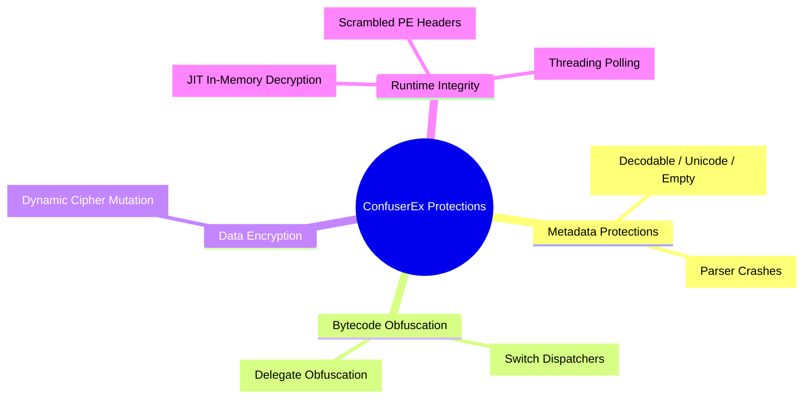

# 🔬 ConfuserEx 8 Core Protections Deep Dive & Deobfuscation Mechanics

---

## 📌 Introduction

ConfuserEx is the standard open-source modular protector for .NET binaries. Utilizing the **dnlib** bytecode manipulation framework, it applies multiple transformational passes directly against CIL method bodies and CLI metadata streams. This paper dissects the 8 primary protections and details their reverse engineering counters.

---

## 🛡️ 1. Taxonomy of the 8 Core Protections

### 1.1 Name Protection (`Confuser.Renamer`)
- **Mechanism**: Modifies `TypeDef`, `MethodDef`, and `FieldDef` metadata entries. Replaces human identifiers with unprintable Unicode sequences or hash tokens.
- **Countermeasure**: Heuristic name normalization via rule-based schema generators (restoring `Class_001`, `Method_001`).

### 1.2 Control Flow Flattening
- **Mechanism**: Splits basic blocks into a single loop governed by an artificial state variable and a dispatching `switch` table.
- **Countermeasure**: Symbolic execution and basic-block dominator tree analysis to reconstruct deterministic branch topologies.

### 1.3 Constant & String Encryption
- **Mechanism**: Extracts literal strings into a hidden encrypted byte array in `.rsrc` or `<Module>`, replacing `ldstr` with dynamic decryption calls (`call string <Module>::DecryptString(id, key)`).
- **Countermeasure**: Emulating decryption helper routines statically or extracting the encrypted resource stream with candidate XOR/DES keys.

### 1.4 Anti-Tamper (JIT-Level Decryption)
- **Mechanism**: Strips CIL bytecode from on-disk PE methods, leaving zeroed bodies. Injects a native module initializer (`<Module>..cctor`) that invokes `VirtualProtect` at startup to decrypt raw method bodies into memory before JIT compilation occurs.
- **Countermeasure**: Dynamic memory dump at JIT compilation boundaries or decrypting the method body stream using the initializer's extracted cryptographic constants.

---

## 📊 2. Comparative Detection Signatures

| Protection | Primary Heuristic Indicator | Forensic Severity |
| :--- | :--- | :---: |
| **Anti-Tamper** | Empty CIL method bodies (`Size = 0`) + Module `.cctor` with native P/Invoke calls | High |
| **Control Flow** | High cyclomatic complexity with dominant switch dispatcher blocks | Medium |
| **Constant Encryption** | Absence of `#US` string references + High-entropy resource streams | High |
| **Anti-Dump** | Corrupted PE Optional Header sizes during memory inspection | Critical |

---

Engineered & Audited by **Maya Thorne** · Low-Level Systems & Reverse Engineering Research
