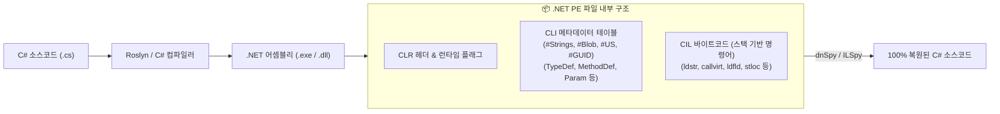
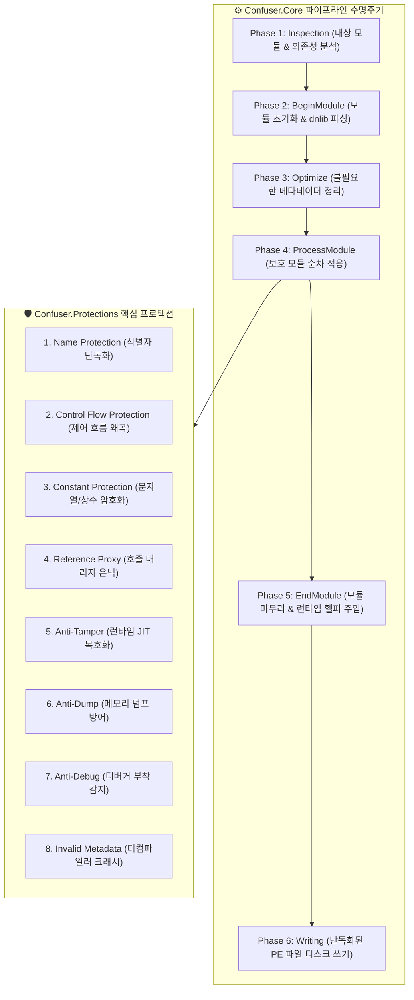

# .NET 어셈블리 난독화 아키텍처 및 ConfuserEx 소스 코드 심층 분석 보고서

---

## 📌 Executive Summary (개요)

C# 및 VB.NET 등 .NET 언어로 작성된 프로그램은 네이티브 기계어로 직접 컴파일되지 않고, **CIL(Common Intermediate Language / MSIL) 중간 언어 바이트코드와 풍부한 CLI 메타데이터(Metadata)** 형태로 컴파일됩니다. 이 구조는 플랫폼 독립성과 JIT(Just-In-Time) 최적화에 탁월하지만, 원본 소스코드의 클래스명, 메서드명, 제어 흐름 구조, 타입 시스템 정보가 100% 보존되어 **dnSpy, ILSpy, dotPeek 등의 디컴파일러를 통해 거의 완전한 C# 원본 소스로 즉시 복원되는 치명적인 역분석 취약점**을 갖습니다.

본 문서는 `[01_백신우회_난독화]\01_DOTNET_난독화`에 포함된 대표적인 오픈소스 .NET 보호기인 **ConfuserEx**의 내부 아키텍처 및 소스 코드를 분해하고, 함께 보관된 엔터프라이즈 난독화 도구군(.NET Reactor, Babel, Eazfuscator 등)의 보호 원리와 디컴파일 방어 메커니즘을 심층 분석합니다.

---

## 🏗️ 1. .NET 런타임 구조와 역분석의 본질



### 1.1 메타데이터 테이블의 투명성
- **`#Strings` 스트림**: 모든 타입명, 메서드명, 필드명, 네임스페이스가 평문 UTF-8 문자열로 저장됩니다.
- **`#US` (User String) 스트림**: 소스코드에 하드코딩된 모든 문자열 리터럴(`"admin"`, `"sql_password"` 등)이 UTF-16LE 평문으로 인덱싱됩니다.
- **CIL 명령어 구조**: 고수준의 제어 구문(try-catch, foreach, switch)과 타입 변환이 정형화된 IL 바이트코드로 일대일 매핑되어 디컴파일러가 AST(추상 구문 트리)를 오차 없이 재구성할 수 있습니다.

---

## ⚙️ 2. ConfuserEx 시스템 아키텍처 (`ConfuserEx-GUI`)

ConfuserEx는 **dnlib** 라이브러리를 기반으로 .NET 바이너리를 메모리 상에서 객체 모델로 파싱한 후, 다단계 파이프라인(Pipeline Phase)을 거쳐 메타데이터와 바이트코드를 재구성하는 모듈형 프로텍터입니다.



---

## 🔍 3. ConfuserEx 8대 핵심 프로텍션 기술 원리

### 3.1 명칭 난독화 (`Confuser.Renamer.dll`)
- **원리**: 메타데이터의 `TypeDef`, `MethodDef`, `FieldDef` 심볼명을 무의미하거나 디컴파일러가 파싱하기 어려운 문자열로 치환합니다.
- **모드 (Renaming Mode)**:
  - `Empty`: 이름을 공백(Zero-width) 또는 허용되지 않는 제어 문자로 치환.
  - `Unicode`: 눈으로 구분할 수 없는 유사한 유니코드(동형이의 문자) 조합으로 치환.
  - `Decodable`: `_a1`, `_b2` 형태의 짧은 고유 해시명으로 치환.
- **BAML & 리플렉션 분석기 (BAML / Reflection Analyzers)**:
  - WPF 애플리케이션의 XAML 리소스(`BAML`) 내부에서 바인딩된 프로퍼티명, JSON 직렬화 필드, 리플렉션으로 호출되는 심볼을 자동 인식하여 해당 이름은 보존(Exclude)함으로써 프로그램의 런타임 크래시를 방지합니다.

---

### 3.2 제어 흐름 왜곡 (`ControlFlowProtection`)

코드의 논리적 실행 순서를 인위적으로 파괴하여 인간의 코드 가독성과 디컴파일러의 AST 재구성을 마비시킵니다.

```csharp
// 원본 C# 코드
int a = 10;
int b = 20;
int c = a + b;
Console.WriteLine(c);

// Control Flow Flattening (스위치 디스패처 상태 머신으로 왜곡된 CIL 로직)
int state = 3;
int a, b, c;
while (state != 0) {
    switch (state) {
        case 3:
            a = 10;
            state = 1; // 상태 전이
            break;
        case 1:
            b = 20;
            state = 4;
            break;
        case 4:
            c = a + b;
            state = 2;
            break;
        case 2:
            Console.WriteLine(c);
            state = 0; // 종료 상태
            break;
    }
}
```

- **블록 분할 (Basic Block Splitting)**: 메서드 바디를 수많은 기본 블록(Basic Block)으로 잘게 쪼갭니다.
- **상태 머신 평탄화 (Control Flow Flattening)**: 루프와 스위치문(`switch`)을 삽입하여 선형 코드를 상태 기반 디스패처 루프로 재구성합니다.
- **불투명 술어 (Opaque Predicates)**: 항상 참(`true`) 또는 거짓(`false`)으로 평가되는 복잡한 수학적 조건문(예: `x * (x + 1) % 2 == 0`)을 삽입하여 거짓 분기(Dead Code)를 대량 생성합니다.

---

### 3.3 상수 및 문자열 암호화 (`ConstantProtection`)
- **원리**: 소스코드의 모든 문자열 리터럴을 추출하여 바이트 배열로 변환하고, 동적 암호화 엔진(`Confuser.DynCipher`)을 이용해 암호화한 뒤 어셈블리의 데이터 섹션에 은닉합니다.
- **런타임 복호화 헬퍼**:
  - `ldstr "SensitivePassword"` 명령어는 제거되고, `call string <Module>::DecryptString(int token, int key)` 호출로 치환됩니다.
  - 암호화 키와 알고리즘은 빌드 시점마다 수학적으로 다형성 변이(Polymorphic Mutation)되어 정적 시그니처 매칭을 무력화합니다.

---

### 3.4 참조 대리자 프록시 (`ReferenceProxyProtection`)
- **원리**: 외부 어셈블리(예: `System.IO.File`, `System.Net.Sockets`)의 메서드를 직접 호출하는 `call` / `callvirt` 명령어를 제거합니다.
- **동적 대리자 은닉**:
  - 런타임에 동적으로 대리자(Delegate)를 생성하거나 호출 헬퍼를 거치도록 변경하여, 바이너리의 메타데이터 `MemberRef` 테이블만 보고 어떤 시스템 API를 사용하는지 파악하는 것을 차단합니다.

---

### 3.5 안티 탬퍼링 (`AntiTamperProtection` - JIT 메모리 복호화)
- **최고 수준의 CIL 보호 기법**:
  1. **빌드 단계**: 어셈블리 내 모든 메서드의 IL 바이트코드를 통째로 암호화하고, 디스크 PE 파일의 메서드 바디 영역을 `0` 또는 NOP으로 비워둡니다. (디컴파일러로 열면 메서드 본문이 비어 있거나 손상됨으로 표시됨).
  2. **모듈 이니셜라이저 주입**: 전역 진입점인 `<Module>..cctor`에 네이티브 메모리 복호화 루틴을 주입합니다.
  3. **런타임 단계**: CLR이 어셈블리를 로드하는 극초기 시점에, 모듈 이니셜라이저가 `VirtualProtect`로 메모리 권한을 변경하고 메모리 상의 CIL 바이트코드를 원래대로 복호화하여 JIT 컴파일러에게 전달합니다.

---

### 3.6 안티 덤프 및 안티 디버그 (`AntiDumpProtection`, `AntiDebugProtection`)
- **Anti-Dump**:
  - 프로세스가 기동되자마자 자신의 PE 헤더(`IMAGE_DOS_HEADER`, `IMAGE_NT_HEADERS`, `SectionHeaders`)의 크기와 주소 필드를 메모리 상에서 손상(Scramble)시킵니다.
  - MegaDumper, Scylla 등의 도구가 프로세스 메모리를 스캔하여 정상적인 PE 포맷으로 덤프하지 못하도록 강제 크래시를 유발합니다.
- **Anti-Debug**:
  - `System.Diagnostics.Debugger.IsAttached`, `Debugger.IsLogging()` 및 Win32 `CheckRemoteDebuggerPresent`, `NtQueryInformationProcess`를 별도 백그라운드 스레드에서 주기적으로 폴링하여 디버거 감지 시 프로세스를 즉시 종료합니다.

---

### 3.7 유효하지 않은 메타데이터 주입 (`InvalidMetadataProtection`)
- **원리**: CLR(Common Language Runtime) 표준 구현체는 실행 시 필수 메타데이터 외의 사소한 파싱 오류를 무시하고 넘어가지만, 서드파티 분석 도구(ILSpy, 옛 버전 dnSpy, de4dot)는 엄격한 파서를 사용하여 예외를 발생시키는 점을 악용합니다.
- 잘못된 스트림 헤더, 가짜 테이블 레코드, 순환 상속 구조를 메타데이터에 인위적으로 삽입하여 디컴파일러의 파서를 크래시시킵니다.

---

## 🏢 4. 디렉터리 내 엔터프라이즈 난독화 도구군 아키텍처 비교

`01_DOTNET_난독화` 폴더에는 ConfuserEx 외에도 상용 엔터프라이즈 보호기들이 구비되어 있습니다:

| 도구명 | 핵심 보호 아키텍처 | 특징 및 강점 |
| :--- | :--- | :--- |
| **ConfuserEx** | 오픈소스 모듈형 파이프라인 (dnlib 기반) | 커스텀 규칙 및 플러그인 확장 가능, Anti-Tamper 및 CIL 평탄화 탁월 |
| **.NET Reactor** (Eziriz) | 네이티브 래퍼 + NecroBit CIL 치환 | .NET 어셈블리를 네이티브 x86/x64 PE로 감싸며, 런타임 네이티브 훅으로 CIL을 주입하여 정적 디컴파일 원천 차단 |
| **Babel Obfuscator** | 크로스 어셈블리 통합 최적화 & 난독화 | 복수 어셈블리 간 심볼 연동 난독화, 데드 코드 제거, IL 인라이닝 |
| **Eazfuscator.NET** | 상용 코드 가상화 (Virtualization) 탑재 | .NET 바이트코드를 독자 VM 바이트코드로 가상화 컴파일하여 디컴파일 완전 무력화 |
| **ArmDot** | 가상 머신 기반 .NET 가상화 | 메서드 단위 VM 명령어 변환 지원 |
| **DeepSea Obfuscator** | 클래식 암호화 & 제어 흐름 난독화 | 직관적인 GUI 설정 및 어셈블리 무결성 보호 |
| **IntelliLock** | 라이선스 관리 결합형 엔벨로프 프로텍터 | 하드웨어 락, 만료일 통제, Trial 평가판 생성 통합 |

---

## 🛠️ 5. 디오브퍼스케이션 및 분석 대응 기법 (Deobfuscation Takeaways)

보안 분석가 및 리버스 엔지니어는 다음과 같은 단계로 난독화된 .NET 어셈블리를 해제합니다:

1. **정적 탈피 (de4dot 활용)**:
   - `de4dot`을 통해 ConfuserEx의 명칭 난독화 패턴(Decodable)을 복원하고, 문자열 암호화 헬퍼 메서드를 정적 에뮬레이션하여 평문 문자열을 원복시킵니다.
2. **동적 덤프 (Runtime Memory Dump)**:
   - Anti-Tamper가 적용된 경우 정적 파일에는 CIL이 없으므로, 바이너리를 일시 중단점(Break-on-JIT)까지 실행시킨 뒤 `<Module>..cctor`에 의해 메모리 상에서 복호화가 완료된 어셈블리를 `ExtremeDumper`나 `dnSpy Debugger`로 인메모리 덤프합니다.
3. **제어 흐름 복원 (De-flattening)**:
   - 심각하게 왜곡된 스위치 디스패처 루프는 `dnSpyEx`의 플러그인이나 기호 실행(Symbolic Execution) 스크립트를 적용하여 상태 변수의 전이 조건을 추적하고 원래의 `if-else` 분기로 재구성합니다.
