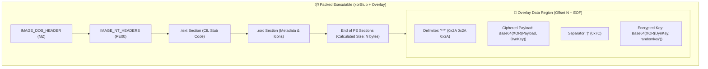

# 🔬 xorPacker & PE Overlay Dual-XOR Deobfuscation Forensics

---

## 📌 Executive Summary

Modern malware authors and penetration testers frequently employ **PE Overlay Packers** to conceal malicious payloads from signature-based antivirus scanners without modifying the compiled executable headers. **xorPacker** exemplifies this paradigm: it appends an encrypted payload to a benign-looking C# stub (`xorStub.exe`) using a dynamic two-stage XOR cipher separated by custom delimiters.

This technical paper analyzes the byte-level construction of xorPacker overlays, the dual-XOR key derivation algorithm, and provides a fully automated static forensic extraction pipeline.

---

## 🏗️ 1. PE Overlay Architecture & Delimiter Structure

A portable executable (PE) file consists of DOS/NT headers, Section Headers, and section raw data. Any data residing beyond the calculated raw size of the last section (`SizeOfRawData + PointerToRawData`) is considered an **Overlay (Extra Data)**. Windows PE loaders ignore overlay data during memory mapping, allowing runtime stubs to read their own binary image from disk and extract embedded configurations.



---

## ⚙️ 2. Key Derivation & Dual-XOR Cryptanalysis

### 2.1 The Delimiter Protocol
The stub locates its payload by seeking the ASCII sentinel sequence `***` (`0x2A 0x2A 0x2A`):
```csharp
string stubSettings = Encoding.ASCII.GetString(stubBytes)
    .Substring(Encoding.ASCII.GetString(stubBytes).IndexOf("***"))
    .Replace("***", "");
```

The extracted string is structured as:
$$\text{stubSettings} = \text{CipheredPayload} \parallel \text{"|"} \parallel \text{EncryptedKey}$$

### 2.2 Dual-Stage XOR Equations
1. **Master Secret ($K_{\text{master}}$)**: Hardcoded 9-byte ASCII string `"randomkey"`.
2. **Dynamic Session Key ($K_{\text{dyn}}$)**:
   $$K_{\text{dyn}}[i] = \text{Base64Decode}(\text{EncryptedKey})[i] \oplus K_{\text{master}}[i \pmod 9]$$
3. **Decrypted Executable Payload ($P_{\text{PE}}$)**:
   $$P_{\text{PE}}[j] = \text{CipheredPayload}[j] \oplus K_{\text{dyn}}[j \pmod{|K_{\text{dyn}}|]}$$

### 2.3 Cryptographic Weakness
Because the outer encryption relies on a static master key (`"randomkey"`), static deobfuscation is completely deterministic:
- No dynamic execution or sandbox emulation is required.
- The raw byte payload can be carved and decrypted in sub-millisecond static passes.

---

## 🛠️ 3. Automated Forensic Extraction Pipeline

Our Python toolchain implements zero-dependency overlay parsing:
1. **Section Alignment Calculation**: Reads PE `NumberOfSections` and computes $\max(\text{PointerToRawData} + \text{SizeOfRawData})$.
2. **Sentinel Detection**: Searches for sentinel bytes `***` from section EOF.
3. **Key Recovery**: Decodes Base64 key chunk and inverts XOR with `"randomkey"`.
4. **Binary Reconstruction**: Streams decrypted bytes into a validated standalone PE executable.

---

<sub>Engineered & Audited by **Maya Thorne** · Low-Level Systems & Reverse Engineering Research</sub>
